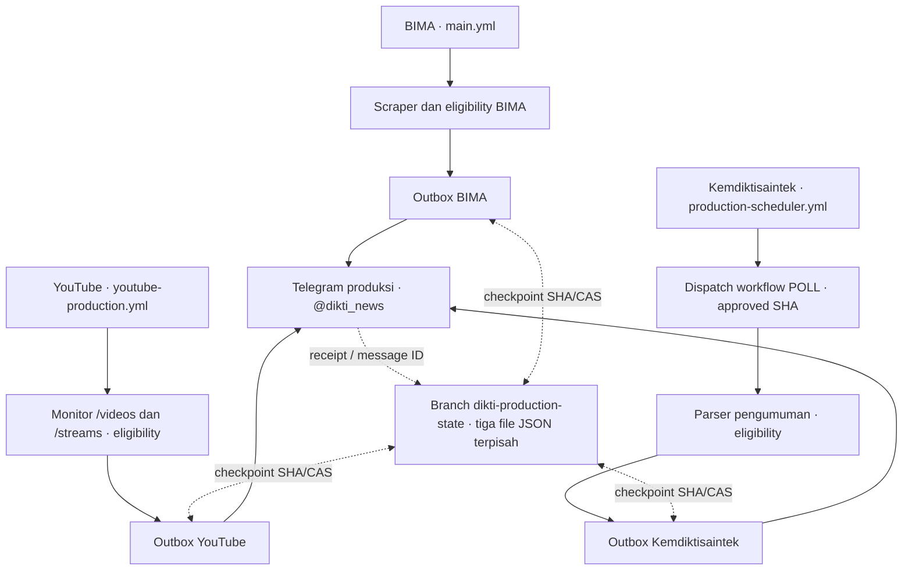

# Dikti News Bot — Monitoring Informasi Pendidikan Tinggi

Bot Python yang memantau informasi dari tiga sumber resmi Kementerian Pendidikan Tinggi, Sains, dan Teknologi (Kemdiktisaintek) dan mengirim pemberitahuan yang memenuhi kriteria ke kanal Telegram **[@dikti_news](https://t.me/dikti_news)**:

- 🏛️ **[BIMA](https://bima.kemdiktisaintek.go.id/pengumuman)** — pengumuman pendanaan, penelitian, pengabdian, dan program terkait; ringkasan serta lampiran PDF yang tersedia.
- 📺 **[YouTube Kemdiktisaintek](https://www.youtube.com/@kemdiktisaintek)** — video reguler dan rekaman siaran langsung (replay) yang telah terverifikasi.
- 📢 **[Pengumuman situs Kemdiktisaintek](https://kemdiktisaintek.go.id/announcement)** — pengumuman resmi, tenggat jika ada, dan dokumen PDF yang memenuhi persyaratan.

Monitoring berjalan melalui GitHub Actions tanpa memerlukan komputer lokal yang terus menyala. Tiap sumber mempunyai kebijakan kelayakan, baseline, dan state operasional tersendiri untuk mencegah pengiriman ulang konten lama. Pengiriman Telegram bukan arsip lengkap semua konten sumber.

**Status per 25 Oktober 2026:** BIMA dan YouTube telah beroperasi di kanal produksi. Sumber pengumuman situs Kemdiktisaintek telah **ARMED** (scheduler dan AUTO_SEND aktif), tetapi pada pemeriksaan terakhir belum ada pengumuman baru yang layak dikirim; pengiriman berita nyata pertama dari sumber tersebut **belum terkonfirmasi**. Lihat [workflow produksi](#workflow-produksi) dan [catatan sumber ketiga](README_KEMDIKTISAINTEK_PRODUCTION.md).


## Workflow produksi

| Sumber | Workflow | Cron (UTC) | Waktu WIB | Keluaran |
|---|---|---|---|---|
| BIMA | [BIMA Pengumuman Checker](.github/workflows/main.yml) | `13 */3 * * *` | 01.13, 04.13, 07.13, 10.13, 13.13, 16.13, 19.13, 22.13 | Ringkasan serta PDF jika tersedia |
| YouTube | [YouTube Production](.github/workflows/youtube-production.yml) | `23,53 * * * *` | Menit 23 dan 53 setiap jam | Video/replay yang memenuhi eligibility |
| Kemdiktisaintek | [Production Scheduler](.github/workflows/kemdiktisaintek-production-scheduler.yml) → [Production (Manual, Gated)](.github/workflows/kemdiktisaintek-production.yml) | `7,37 * * * *` | Menit 07 dan 37 setiap jam | Pengumuman dan dokumen resmi jika memenuhi eligibility |

BIMA dan YouTube menjalankan `production_runtime.py`; scheduler Kemdiktisaintek mengirim *workflow dispatch* `POLL` ke workflow produksi tersendiri dengan pemeriksaan approved SHA. Ketiganya menggunakan state terpisah dalam branch `dikti-production-state` dan *concurrency group* bersama saat melakukan operasi produksi terhadap branch state.

Cron GitHub Actions menggunakan UTC. Waktu pada tabel adalah jadwal nominal, **bukan jaminan** eksekusi tepat waktu: run dapat terlambat atau terlewat. Run yang menunggu dalam concurrency group juga bisa tergantikan jika beberapa pemicu bertabrakan. Periksa halaman [Actions](https://github.com/Galih-Hermawan-Unikom/bima-dikti-news/actions) untuk hasil aktual.

Kemdiktisaintek menggunakan dua saklar sumber/scheduler dan satu saklar pengiriman; detailnya ada di [konfigurasi produksi](#variables-dan-kill-switch). Workflow observasi dan eksperimen tidak boleh disamakan dengan jalur pengiriman produksi.


## Arsitektur



Setiap sumber mempunyai identitas event, initial inventory, activation fence, dan kebijakan klasifikasi sendiri. Reservasi serta percobaan pengiriman dicatat secara persisten melalui GitHub Contents API (SHA/CAS) sebelum Telegram POST. Pengiriman yang tidak pasti tidak diulang otomatis; operator perlu melakukan rekonsiliasi. **Diagram ini menunjukkan tiga pipeline terpisah, bukan satu agregator lintas-sumber.**

Branch `master` menyimpan kode dan referensi historis yang dibaca produksi; branch `dikti-production-state` menyimpan state operasional, termasuk receipt. Workflow produksi BIMA, YouTube, dan Kemdiktisaintek memakai group `dikti-production-state` dengan `cancel-in-progress: false`; pengaturan ini tidak menjamin bahwa seluruh run pending akan dieksekusi.

## Aturan deteksi dan kelayakan

### BIMA

- Pengumuman dibandingkan dengan cache, jurnal historis, initial inventory, dan outbox produksi menggunakan identitas pengumuman kanonis.
- Capture startup menjadi **initial inventory** dan tidak dikirim. Activation fence disimpan saat inisialisasi menggunakan waktu UTC aktual.
- Karena sumber BIMA menyediakan tanggal tanpa jam, tanggal publikasi harus **sesudah tanggal aktivasi dalam WIB** dan tidak boleh melampaui tanggal observasi. Pengumuman pada hari aktivasi atau lebih lama tidak otomatis memenuhi syarat.
- Kandidat yang pertama kali terlihat lebih dari 24 jam lalu ditahan. Tidak ada backfill otomatis.
- Ringkasan memakai HTML Telegram; dokumen dikirim dengan nama metadata yang aman, bukan nama tempfile.

**PDF produksi ON.** `main.yml` menetapkan `TELEGRAM_SEND_FILES: 'true'`, dan runtime produksi secara eksplisit memakai `telegram_send_files=True`. Nilai `telegram_send_files: false` dalam `config.json` tidak mematikan lampiran pada jalur produksi ini. Jumlah lampiran mengikuti dokumen yang tersedia pada pengumuman.

### YouTube tabs-only

Kebijakan produksi `tabs-only-v1` memakai `first_seen_at` persisten. Nilai ini adalah waktu observasi pertama, **bukan `published_at`** dan bukan bukti bahwa video baru diterbitkan.

Video hanya dapat dikirim jika seluruh syarat terpenuhi:

1. Identitas belum dikenal cache/baseline/jurnal, bukan initial inventory, dan pertama kali teramati setelah activation fence produksi.
2. Kedua tab `/videos` dan `/streams` sehat, dengan dua capture yang stabil dan berjarak minimal **10 menit**.
3. Identitas kanal, provenance observasi, kategori, dan readiness tervalidasi. Keanggotaan tab dapat menjadi bukti kategori sesuai kebijakan, tetapi tidak menggantikan pemeriksaan kondisi lain.
4. `/videos`: video reguler yang telah publik dan terverifikasi. `/streams`: hanya **completed replay** dengan bukti penyelesaian yang tervalidasi pada observasi stabil.
5. Bukti masih segar, tidak bertentangan, dan event belum pernah dikirim atau memiliki status pengiriman ambigu.

Shorts ditolak. LIVE, upcoming, kategori UNKNOWN, replay yang belum terbukti siap, capture parsial/gagal, atau bukti tidak cukup tetap **HOLD** dan tidak dikirim. UNKNOWN adalah status pengetahuan identitas, bukan izin pengiriman; hanya keputusan **ELIGIBLE** yang dapat masuk jalur pengiriman.

| Parameter produksi | Nilai |
|---|---|
| Window sejak `first_seen_at` | 24 jam |
| Evidence TTL | 4 jam |
| Clock skew | 5 menit |
| Jarak minimum capture | 10 menit |

Pembaca tab dibatasi 30 item per tab; pagination belum ditangani. Video yang tidak terlihat pada satu capture tidak dianggap dihapus. Perubahan metadata tidak menjadikan `video_id` lama sebagai video baru. Runtime YouTube mengirim maksimal satu event baru per siklus.


### Pengumuman situs Kemdiktisaintek

Sumber ini memantau [halaman pengumuman resmi](https://kemdiktisaintek.go.id/announcement) secara independen dari BIMA, menggunakan UUID pengumuman sebagai identitas. Pengumuman baru tidak otomatis dikirim hanya karena muncul dalam hasil pengambilan data:

- Kandidat harus melewati pemeriksaan kesehatan sumber, waktu publikasi/observasi, detail terpercaya, relevansi, baseline, dan activation fence.
- Artikel yang sudah ada saat inisialisasi tidak dikirim ulang. Kandidat revisi memerlukan pemeriksaan; tidak diperlakukan sebagai berita baru secara otomatis.
- Ringkasan memuat judul, tanggal, nomor surat dan tenggat **jika tersedia**, tautan sumber, serta daftar dokumen. PDF resmi yang memenuhi validasi dapat dikirim lewat `sendDocument`.
- Outbox dan receipt terpisah dari BIMA/YouTube. `AMBIGUOUS` atau pengiriman parsial perlu rekonsiliasi operator, tanpa retry otomatis.
- Inventaris baseline hanya meliputi jendela pengamatan terbaru (`archive_complete=false`), **bukan klaim telah mengarsipkan seluruh pengumuman historis**.

Pada checkpoint aktivasi 25 Oktober 2026, jalur ini berstatus **ARMED**, tanpa pengiriman artikel baru yang telah dikonfirmasi. Lihat [dokumentasi integrasi awal](README_KEMDIKTISAINTEK_PRODUCTION.md); beberapa petunjuk aktivasi di sana merupakan catatan historis, bukan status operasional terbaru.

## State, deduplikasi, dan pemulihan

| Lokasi | Peran |
|---|---|
| `master/announcements_cache.json` | Referensi historis BIMA: 90 entri. |
| `master/youtube_cache.json` | Referensi historis YouTube: 129 entri. |
| `master/delivery_state.json` | Jurnal historis dan baseline 133 ID YouTube. Identitas Shorts historis tetap disimpan untuk penekanan replay, tanpa memonitor Shorts. |
| Branch `dikti-production-state`, `.bot-state/bima_production.json` | Activation fence, initial inventory, first-seen, outbox, progres dokumen, dan receipt produksi BIMA. |
| Branch `dikti-production-state`, `.bot-state/youtube_production.json` | Activation fence, initial inventory, capture/observasi persisten, event key, outbox, dan receipt produksi YouTube. |
| Branch `dikti-production-state`, `.bot-state/kemdiktisaintek_production.json` | Baseline UUID, activation fence, observasi, admission, durable outbox, dan receipt sumber pengumuman Kemdiktisaintek. |
| Branch `youtube-state`, `.bot-state/youtube_delivery_state.json` | State eksperimen, terpisah dari produksi; tidak menjadi fallback produksi. |

File historis di `master` hanya dibaca oleh runtime produksi; jumlah referensinya diperiksa, dan hash ketiganya dibandingkan sebelum/sesudah eksekusi. State operasional baru disimpan pada branch state, bukan ditulis kembali ke cache historis.

Saat inisialisasi, video/pengumuman yang sudah terlihat dimasukkan ke initial inventory tanpa pengiriman. Fence dan inventory tetap digunakan setelah restart; inisialisasi terhadap state yang sudah diinisialisasi tidak menimpanya. Jangan menghapus state, mengubah fence, atau mereset inventory untuk memaksa pengiriman.

Setiap event memakai kunci idempoten: BIMA berdasarkan identitas pengumuman kanonis, YouTube berdasarkan `video_id` dan event awal, serta Kemdiktisaintek berdasarkan UUID sumber. Sebelum Telegram dipanggil, reservasi dan status percobaan pengiriman harus berhasil tersimpan di remote melalui **GitHub Contents API dengan SHA/CAS**. Konflik SHA atau kegagalan checkpoint menghentikan proses; tidak ada fallback ke salinan lokal yang basi.

Status outbox:

| Status | Makna dan tindakan |
|---|---|
| `reserved` | Reservasi tersimpan; belum ada percobaan pengiriman yang diklaim. |
| `sending` | Percobaan sudah diklaim secara durable sebelum API Telegram. |
| `delivered` | Respons terkonfirmasi: HTTP 200, `ok=true`, dan `message_id` valid; receipt disimpan. |
| `ambiguous` | Hasil tidak dapat dipastikan, termasuk pemulihan percobaan yang terputus. Wajib rekonsiliasi operator; tidak dikirim ulang otomatis. |

Jalur produksi membatasi satu percobaan per event. Untuk BIMA, satu percobaan mencakup ringkasan dan lampirannya; progres yang berhasil disimpan per checkpoint. Jika sebagian terkirim, jangan mengulang seluruh pengumuman. Perlindungan ini menghindari resend otomatis saat hasil jaringan tidak pasti, tetapi bukan jaminan bahwa setiap gangguan selalu menghasilkan pesan terkirim.

### Controlled backfill

Backfill bukan bagian dari siklus terjadwal. Pengecualian yang tersedia dibatasi pada **satu identitas BIMA** melalui mode manual `backfill-1454`, dengan pemeriksaan judul, nomor surat, tanggal, sumber resmi, PDF, ukuran/hash, jurnal, dan outbox. Mode ini memakai kunci event serta reservasi CAS produksi yang sama. Event yang sudah delivered menghasilkan `SKIPPED`; status pending/ambigu memerlukan rekonsiliasi.

Contoh yang telah selesai:

- Surat `1454/DST/C3/DT.06.01/2026`, tanggal **22 Oktober 2026**.
- **Pemberitahuan Jadwal Pelaporan dan Monitoring dan Evaluasi Internal Program Pengabdian kepada Masyarakat Tahun Anggaran 2026**.
- Ringkasan Telegram [#272](https://t.me/dikti_news/272) dan PDF [#273](https://t.me/dikti_news/273), keduanya HTTP 200 dan `ok=true`; outbox berstatus `delivered`.
- PDF utama berukuran **285.439 byte**. Receipt dan bukti pengecualian tersimpan pada outbox produksi.

Keberhasilan tersebut tidak membuka backfill umum. Pengecualian identitas lain memerlukan keputusan operator dan pemeriksaan tersendiri, bukan penghapusan histori atau perubahan activation fence.

## Konfigurasi GitHub Actions produksi

Atur melalui **Settings → Secrets and variables → Actions**. Jangan menaruh token atau chat ID aktual dalam kode, log, issue, atau repository.

### Secrets

| Nama | Kegunaan |
|---|---|
| `TELEGRAM_BOT_TOKEN` | Token bot produksi yang memiliki hak posting pada kanal resmi. |
| `TELEGRAM_CHAT_ID` | Tujuan produksi: ID numerik kanal resmi yang terverifikasi atau `@dikti_news`. |
| `GITHUB_TOKEN` | Disediakan otomatis oleh GitHub Actions; workflow meminta `contents: write` untuk checkpoint branch state. Tidak perlu menyalin token ini ke repository. |

### Variables dan kill switch

| Nama | Nilai untuk produksi aktif | Fungsi |
|---|---|---|
| `PRODUCTION_TELEGRAM_CHAT_ID_SHA256` | SHA-256 ID numerik kanal resmi | Allowlist wajib. Hash dihitung dari string ID numerik UTF-8 tanpa spasi/newline, **bukan** dari `@dikti_news`. |
| `BIMA_PRODUCTION_ENABLED` | `true` | Mengizinkan job BIMA terjadwal. |
| `BIMA_PRODUCTION_AUTO_SEND` | `true` | Mengizinkan pengiriman BIMA. Ubah menjadi `false` untuk menghentikan pengiriman tanpa menghapus state. |
| `YOUTUBE_PRODUCTION_ENABLED` | `true` | Mengizinkan job YouTube terjadwal. |
| `YOUTUBE_PRODUCTION_AUTO_SEND` | `true` | Mengizinkan pengiriman YouTube. Ubah menjadi `false` untuk menghentikan pengiriman tanpa menghapus state. |
| `KEMDIKTISAINTEK_PRODUCTION_ENABLED` | `true` | Mengizinkan operasi sumber Kemdiktisaintek. |
| `KEMDIKTISAINTEK_PRODUCTION_SCHEDULER_ENABLED` | `true` | Mengaktifkan dispatch terjadwal sumber Kemdiktisaintek. |
| `KEMDIKTISAINTEK_PRODUCTION_AUTO_SEND` | `true` | Mengizinkan pengiriman kandidat Kemdiktisaintek yang lolos kriteria; set `false` untuk menghentikan pengiriman. |
| `KEMDIKTISAINTEK_PRODUCTION_APPROVED_CODE_SHA` | SHA penuh HEAD `master` yang ditinjau | Wajib cocok dengan SHA dispatch; commit baru pada `master` memerlukan rollover approved SHA yang terkendali. |

Saklar boolean produksi menggunakan string persis `true`; default adalah **OFF** jika tidak diatur. Pengiriman setiap sumber mensyaratkan saklar source dan auto-send aktif. Kemdiktisaintek memerlukan approved SHA yang cocok dengan `master`, serta scheduler switch untuk polling otomatis. **Jangan menghapus baseline atau mereset state** untuk memaksa pengiriman. Setelah merge apa pun ke `master`, periksa rollover approved SHA sebelum scheduler berikutnya.

Setiap eksekusi produksi menjalankan preflight read-only `getMe`, `getChat`, dan `getChatMember`: identitas kanal harus cocok dengan kanal resmi serta hash allowlist, dan bot harus memiliki hak posting. Tujuan pengiriman dipin ke ID numerik yang telah diverifikasi. Kredensial eksperimen tidak dipakai sebagai fallback. Jika verifikasi gagal, proses berhenti sebelum pengiriman.

Branch `dikti-production-state` harus tersedia dan dapat ditulis oleh workflow. Mode `initialize` membuat state yang belum ada dengan UTC aktual serta initial inventory tanpa pengiriman; bukan alat reset. Mode `preflight` hanya memeriksa tujuan dan izin tanpa mengirim Telegram atau menginisialisasi state. Mode `run` menjalankan siklus normal menggunakan state yang sudah tersedia.

## Lokal, eksperimen, dan produksi

| Lingkungan | Penggunaan |
|---|---|
| Lokal | Pengembangan, regression tests, serta dry-run dengan direktori state terisolasi. `config.json` dan `.env` lokal tidak mengatur runtime produksi Actions. |
| Eksperimen | Workflow [YouTube Observation Only](.github/workflows/youtube-observation-only.yml) hanya melalui `workflow_dispatch` (manual), tanpa `schedule`; branch `youtube-state` dan kredensial/allowlist eksperimen tersendiri. Auto-send dikendalikan `YOUTUBE_EXPERIMENT_AUTO_SEND`; tetap OFF. |
| Produksi | Tiga sumber dengan workflow masing-masing; BIMA dan YouTube langsung terjadwal, Kemdiktisaintek melalui scheduler → dispatch POLL; semuanya memakai kredensial kanal resmi dan branch `dikti-production-state`. |

Eksperimen memakai secrets `YOUTUBE_EXPERIMENT_BOT_TOKEN`, `YOUTUBE_EXPERIMENT_CHAT_ID`, dan `YOUTUBE_EXPERIMENT_CHAT_ID_SHA256`. Jangan menyalin state atau kredensial eksperimen ke produksi.

Untuk pengembangan lokal, gunakan Python 3.11 dan virtual environment:

```bash
git clone https://github.com/Galih-Hermawan-Unikom/bima-dikti-news.git
cd bima-dikti-news
python -m venv .venv
# Aktifkan virtual environment sesuai shell yang digunakan.
pip install -r requirements-dev.txt
playwright install chromium
python -m pytest
```

Untuk dry-run, salin ketiga file referensi historis ke direktori terisolasi di luar worktree Git, lalu jalankan:

```bash
python run_github.py --dry-run --youtube-eligibility --state-dir <direktori-state-terisolasi>
```

Perintah dry-run mengevaluasi sumber publik tanpa pengiriman Telegram. Satu capture belum cukup untuk membuktikan stabilitas. Gunakan fixture dan notifier mock untuk pengujian delivery; jangan memakai kredensial produksi dalam eksperimen lokal. `production_runtime.py` sendiri mensyaratkan lingkungan GitHub Actions.


## Struktur proyek

```text
.github/workflows/
  main.yml                               # BIMA produksi
  youtube-production.yml                 # YouTube produksi
  kemdiktisaintek-production-scheduler.yml  # Cron sumber ketiga
  kemdiktisaintek-production.yml         # POLL/INITIALIZE/COLLECT bergate SHA
  telegram-preflight.yml                 # Preflight kanal produksi
  tests.yml                              # Regression suite
  ...                                    # Workflow eksperimen/manual tambahan
production_runtime.py                    # Runtime BIMA/YouTube
production_preflight.py                  # Pemeriksaan tujuan Telegram
scraper.py / notifier.py                 # Data BIMA dan formatter Telegram
youtube_*.py                             # Pemantauan, eligibility, outbox YouTube
kemdiktisaintek_prod_*.py                # Parser, policy, state, outbox, scheduler sumber ketiga
announcements_cache.json                 # Referensi historis BIMA
youtube_cache.json                       # Referensi historis YouTube
delivery_state.json                      # Jurnal dan baseline historis
docs/                                    # Desain, audit, dan pengujian terdahulu
tests/                                   # Unit/integration tests dan fixtures
.env.example / requirements*.txt         # Konfigurasi contoh dan dependensi
```

Modul Python tetap berada di root agar import dan workflow yang sudah beroperasi tidak berubah. Sebagian workflow observasi/eksperimen menunjuk branch eksperimen dengan script yang tidak terdapat pada `master`; itu bukan jalur produksi. State operasional `.bot-state/` berada pada branch terpisah, **bukan** di root `master`.

## Membaca hasil dan troubleshooting

Siklus produksi normal menulis satu baris `PRODUCTION_RUN=` diikuti JSON. Interpretasikan field bersama status job dan outbox, bukan hanya jumlah kandidat:

| Field/log | Arti |
|---|---|
| `source` | Sumber yang dijalankan: `bima` atau `youtube`; jalur Kemdiktisaintek menggunakan ringkasan `KEMDIKTISAINTEK_PRODUCTION_RUN`. |
| `startup: true` | Capture initial inventory; tidak ada pengiriman startup. |
| `visible` | Jumlah item terlihat; YouTube memisahkan jumlah per tab. Bukan jumlah video baru. |
| `eligible` / `hold` | Hasil evaluasi pada siklus itu; bukan jumlah pesan terkirim. |
| `sending: ON` | Saklar mengizinkan pengiriman; bukan bukti API Telegram telah dipanggil. |
| `confirmed_messages` | Jumlah pesan Telegram terkonfirmasi; pada BIMA mencakup ringkasan dan dokumen. |
| `delivered_events` | Jumlah event yang selesai dikirim, berbeda dari jumlah pesan/lampiran. |
| `activation_at` / `initial_inventory` | Fence tersimpan dan ukuran inventory jika disertakan pada laporan. |
| `capture_seq` | Urutan capture YouTube yang tersimpan. |
| `PRODUCTION_PREFLIGHT=PASS` | Pemeriksaan tujuan/izin berhasil; mode preflight tidak mengirim. |
| `KEMDIKTISAINTEK_PRODUCTION_RUN=` | JSON polling sumber ketiga: `api_health`, `capture_warnings`, `status_counts`, `poll_gap_seconds`, `delivery_enabled`, `delivered_this_poll`. |
| `PRODUCTION_FAIL_CLOSED=...` | Pengamanan menghentikan siklus. Periksa kode kegagalan dan state sebelum bertindak. |

**Job sukses dengan 0 pengiriman adalah hasil normal** saat belum ada konten baru yang memenuhi kebijakan. Untuk Kemdiktisaintek, `delivery_enabled=true` berarti saklar pengiriman aktif, sedangkan `delivery_authorized=false` dengan `NEW_CANDIDATE=0` berarti tidak ada kandidat layak pada polling tersebut. Status **ARMED** belum membuktikan pengiriman produksi pertama. Untuk controlled backfill, baca field `backfill`, `reason`, dan receipt/message ID yang tersedia.

| Gejala | Pemeriksaan aman |
|---|---|
| Job terjadwal dilewati | Periksa status workflow, branch `master`, dan variable `*_PRODUCTION_ENABLED`. |
| Scheduler Kemdiktisaintek tidak mendispatch POLL | Cocokkan `KEMDIKTISAINTEK_PRODUCTION_APPROVED_CODE_SHA` dengan HEAD `master`; periksa scheduler/source switch dan workflow run. Jangan mematikan SHA gate. |
| Kemdiktisaintek `UNHEALTHY_POLL_GAP` | Periksa jarak antar-run dan API health; lihat kemungkinan cron terlambat/terlewat. Jangan backfill atau mengirim arsip otomatis. |
| Run terlambat atau pending tergantikan | Periksa antrean dan log kedua workflow pada concurrency group `dikti-production-state`. Cron menggunakan UTC dan tidak menjamin waktu mulai; `cancel-in-progress: false` tidak melindungi run pending dari penggantian oleh run baru. |
| Eksperimen tidak berjalan otomatis | Sesuai konfigurasi: `youtube-observation-only.yml` tidak memiliki `schedule` dan hanya tersedia melalui `workflow_dispatch` manual. Auto-send eksperimen tetap OFF. |
| Job berjalan tetapi tidak mengirim | Periksa auto-send, inventory/histori, fence, hasil eligibility, dan outbox; jangan menghapus histori. |
| Allowlist atau izin Telegram gagal | Periksa secrets, hash ID numerik resmi, identitas kanal, serta hak admin bot. Jangan mencetak nilai rahasia. |
| YouTube HOLD | Periksa kesehatan kedua tab, jarak/stabilitas capture, kesegaran bukti, kategori, serta replay readiness. Jangan mempromosikan UNKNOWN secara manual tanpa bukti. |
| Konflik CAS/state tidak tersedia | Periksa izin `contents: write`, branch/path state, dan checkpoint terakhir. Jangan memaksa overwrite atau reset branch. |
| Outbox `ambiguous` atau pengiriman parsial | Matikan auto-send sumber terkait bila perlu; cocokkan receipt, message ID, dan riwayat kanal. Tidak ada resend otomatis. |
| PDF BIMA tidak selesai | Periksa ketersediaan/unduhan dokumen dan receipt `sendDocument`. Flag `config.json` bukan saklar PDF produksi; jangan mengulang ringkasan yang sudah terkirim. |
| Chromium tidak tersedia | Pastikan langkah `playwright install --with-deps chromium` pada workflow BIMA berhasil; untuk lokal gunakan `playwright install chromium`. |
| Timeout sumber publik | Periksa log job dan kesehatan sumber; timeout workflow 20 menit. Jangan mengatasi timeout dengan reset cache/outbox. |

## Dokumentasi lanjutan

- [Kebijakan classifier tabs-only](docs/youtube-eligibility-offline.md)
- [Adapter channel-tabs dan verifikasi otomatis](docs/youtube-channel-tabs.md)
- [Observasi persisten dan durable outbox](docs/youtube-persistent-outbox.md)
- [Preflight Telegram eksperimen](docs/telegram-preflight.md)
- [Riwayat audit reliabilitas Fase 1](docs/reliability-phase1.md)
- [Integrasi Kemdiktisaintek (catatan tahap awal)](README_KEMDIKTISAINTEK_PRODUCTION.md)

Perubahan dokumentasi ke `master` juga mengubah SHA commit. Ketika Kemdiktisaintek aktif, operator perlu menyelaraskan approved SHA secara terkendali setelah merge.

Dokumen fase terdahulu menjelaskan desain dan riwayat implementasi. Untuk operasi produksi saat ini, rujuk README ini beserta `production_runtime.py` dan kedua workflow produksi.

## Pengembang

**Galih Hermawan**  
Program Studi Teknik Informatika  
Universitas Komputer Indonesia  

- Website: [https://galih.eu](https://galih.eu)
- Email: [galih.hermawan@gmail.com](mailto:galih.hermawan@gmail.com)
- Threads: [https://www.threads.com/@galihhermawan](https://www.threads.com/@galihhermawan)

## Lisensi

MIT
