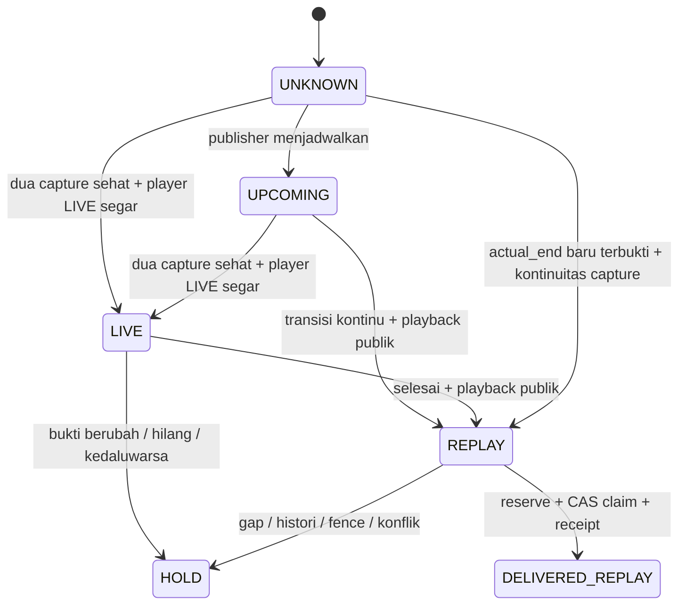

# Lifecycle YouTube produksi

Implementasi stream produksi memakai `LifecycleTabsAdapter` di atas discovery
`/videos` + `/streams`. **Tab `/streams` tidak otomatis membuktikan LIVE.**
Adapter eksperimen lama tetap memakai kontrak `:initial`; lifecycle hanya dapat
dikirim melalui notifier produksi dengan destination/credential checks yang sama.

**Feature OFF sebelum migrasi:** fence kosong mengembalikan hasil adapter legacy
secara langsung. Regular dan completed replay yang memenuhi policy lama tetap
dapat memakai `:initial`; LIVE tetap ditolak. Tidak ada player GET, migrasi, atau
checkpoint lifecycle. Window first-seen 24 jam, TTL, inventory, history, Shorts,
CAS dan outbox legacy tetap berlaku. Ini tidak memperbaiki replay historis yang
sudah kedaluwarsa dan tidak membuka backfill. Setelah state pernah bermigrasi,
mengosongkan fence menahan stream lifecycle agar tidak jatuh ke `:initial` baru.

Diagram menunjukkan fase observasi dan keputusan. Delivery LIVE memiliki outbox
sendiri; delivered LIVE tidak menghalangi REPLAY. HOLD bukan penghapusan identitas.

## Bukti minimum

Discovery mempertahankan parser channel, identity/channel allowlist, dan kesehatan
dua tab. Publisher dibaca melalui anonymous HTTPS GET pada URL watch tetap, tanpa
redirect atau retry. Parser hanya mengekstrak satu `ytInitialPlayerResponse` JSON;
tidak menjalankan JavaScript. Consent page, perubahan struktur, timeout, private,
unlisted, wrong-channel, status playback non-OK, dan bukti bertentangan menghasilkan
UNKNOWN/HOLD. Raw HTML dan URL media bertanda tangan tidak disimpan dalam state.

| Fase | Bukti publisher dan tindakan |
|---|---|
| UPCOMING | `videoDetails.isUpcoming=true`, tanpa LIVE/end yang bertentangan. Observasi saja; tidak ada reservation. |
| LIVE | ID/channel tepat, `isPrivate=false`, `isUnlisted=false`, `isLiveContent=true`, `playabilityStatus.status=OK`, format playback tersedia, start tidak di masa depan, `liveBroadcastDetails.isLiveNow=true`, tanpa end. Jika `videoDetails.isLive` tersedia, nilainya tidak boleh false. |
| COMPLETED_REPLAY | Identitas/public playback sama; `isLiveNow=false`, tanpa flag LIVE yang bertentangan. End timestamp valid dari publisher, atau flag `isLive=false` dengan transisi UPCOMING/LIVE yang diamati kontinu. |
| UNKNOWN / inconsistent | Field wajib hilang, jadwal saja, judul saja, durasi kartu saja, konflik badge/player, Shorts, video berpindah tab/hilang, capture gagal: HOLD. |

Field watch player merupakan format publik yang tidak dijamin stabil. Dokumentasi
[YouTube Data API](https://developers.google.com/youtube/data/reference/rest/v3/videos#liveStreamingDetails)
membedakan jadwal, actual start, dan actual end. Implementasi ini **tidak** memanggil
Data API dan tidak menganggap format watch sebagai kontrak API resmi.

## Waktu, kontinuitas, dan polling gap

`first_seen_at` lama tidak diubah. Untuk stream, jendela 24 jam memakai origin fase:

- LIVE: pengamatan publisher LIVE pertama, disimpan sekali; UPCOMING tidak memulai window ini.
- REPLAY: `actual_end_at` apabila tersedia saat replay pertama diverifikasi; jika
  tidak, `first_verified_replay_at` pada transisi kontinu. Keduanya disimpan terpisah.
  Waktu observasi tidak diklaim sebagai waktu selesai siaran. Origin tidak digeser
  ketika metadata kemudian berubah atau proses restart.

Dua capture harus sehat, identitas/title/URL stabil, berada di `/streams`, dan
berjarak minimal 10 menit serta maksimal 2 jam. Metadata player pada kedua capture
harus menunjukkan fase yang sama untuk pengiriman. Perubahan fase dapat mulai
tercatat pada capture pertama; kandidat baru muncul pada capture konfirmasi.
LIVE boleh pertama kali ditemukan tanpa UPCOMING, tetapi harus tetap LIVE ketika
diperiksa ulang sebelum reservation dan sesudah durable claim. Bukti reservation
berusia maksimal 2 menit, tanpa toleransi timestamp masa depan.

Replay pertama tanpa histori LIVE hanya diterima bila capture global sebelumnya
sehat, jedanya memenuhi batas, dan publisher end terbukti setelah capture tersebut
serta setelah lifecycle fence. Tanpa end, harus ada pengamatan UPCOMING/LIVE tepat
pada capture sebelumnya. Capture pertama setelah gap, capture gagal, atau hilangnya
video bukan bukti transisi baru. Replay yang pertama ditemukan tanpa kontinuitas
tetap dikarantina meskipun dua capture berikutnya sehat; tidak ada reset origin
untuk mengejar window. LIVE dapat kembali memenuhi syarat setelah dua capture LIVE
yang sehat dan berkesinambungan, dengan pemeriksaan playback saat pengiriman.

TTL 4 jam dan skew 5 menit pada policy tabs lama tetap dipakai untuk provenance
capture umum. Batas kontinuitas stream 2 jam dan pemeriksaan player segar lebih
ketat. Cron unified saat ini setiap jam pada menit 17; queued workflow selalu
mengambil capture baru. Queue tidak membuktikan bahwa polling yang hilang terjadi.

## Identitas event dan pengiriman durable

- `youtube:video:<id>:live`: maksimal satu percobaan LIVE yang menghasilkan receipt terkonfirmasi.
- `youtube:video:<id>:replay`: histori REPLAY independen, maksimal satu receipt terkonfirmasi.
- `youtube:video:<id>:initial`: histori legacy tetap utuh, menekan kedua fase baru.

Reservation dan claim `sending` harus berhasil tersimpan melalui remote blob-SHA
CAS sebelum notifier. Worker dengan SHA basi berhenti; lease tidak memberikan izin
retry. Hanya HTTP 200, `ok=true`, dan message ID positif menjadi `delivered`.
Timeout, error, crash setelah POST, atau receipt tak terkonfirmasi menjadi
`ambiguous` / `sending` yang perlu rekonsiliasi. Expired lease menjadi ambiguous.
Reservation lifecycle dari proses sebelumnya juga tidak otomatis dilanjutkan.
Tidak ada perpindahan ambiguous/delivered ke pending. At-most-once berarti suatu
event mungkin tidak terkirim; desain ini memilih tidak menduplikasi pesan.

Notifier menampilkan **🔴 Sedang LIVE | Kemdiktisaintek** atau
**▶️ Rekaman Tersedia | Kemdiktisaintek**, diikuti judul dan URL. Format BIMA dan
Kemdiktisaintek Announcement tidak diubah. Maksimal satu event baru per siklus.

## Migrasi dan activation fence

Skema JSON luar tetap versi 1 dan `policy_version=tabs-only-v1`, agar constructor
tidak memicu quarantine/reinitialization legacy. Ekstensi tervalidasi `lifecycle`
memiliki versi 1 sendiri: fence immutable, `suppressed_ids`, `stream_ids`, dan
record fase. Migrasi hanya menambahkan ekstensi, tanpa mengubah observasi,
first-seen, captures, inventory, outbox, ataupun receipt lama.

Variabel **`YOUTUBE_LIFECYCLE_ACTIVATION_AT`** diteruskan hanya ke job YouTube
(unified dan recovery manual). Default kosong sebelum migrasi: regular dan replay
legacy tetap tersedia, LIVE HOLD. Tidak ada aktivasi otomatis berdasarkan merge.
Fence wajib timezone-aware, tidak sebelum activation produksi lama, dan harus
sudah tercapai. Setelah ekstensi ada, fence berbeda menyebabkan fail-closed.

Pada cutover pertama, seluruh ID yang telah ada dalam observation state masuk
`suppressed_ids`, termasuk UPCOMING lama. Ini sengaja konservatif: hanya identitas
baru pasca-cutover yang dapat mengikuti lifecycle otomatis. ID stream dipertahankan
ketika berpindah tab agar tidak turun menjadi event regular `:initial`.
Legacy cache/baseline/journal dan setiap outbox `:initial`, termasuk reserved atau
ambiguous, tetap menekan pengiriman fase baru.

Sebelum aktivasi terpisah oleh operator: review PR/CI, ambil snapshot state secara
read-only, jalankan migrasi offline dan bandingkan seluruh key legacy, pastikan
ekstensi belum aktif, lalu pilih UTC cutover yang disetujui. Jangan memakai mode
initialize, mereset baseline, mengubah approved SHA, atau memajukan fence untuk
membuka histori. PR ini tidak mengubah Variables/Secrets, mengaktifkan fence,
dispatch, mengirim Telegram, ataupun menulis state produksi.

Untuk rollback setelah migrasi, kosongkan fence hanya melalui prosedur otorisasi
operator: stream kembali HOLD, ekstensi/outbox tetap tersimpan. Penggunaan ulang
harus memakai fence tersimpan yang sama. Jangan kembali ke sender lama yang hanya
mengenal `:initial` tanpa review compatibility atas state yang sudah memiliki fase.

## Audit HOLD oleh operator

1. Baca snapshot `.bot-state/youtube_production.json` pada branch
   `dikti-production-state`, catat commit/blob SHA dan capture sequence.
2. Cari ID dalam baseline/cache/jurnal legacy, observation `first_seen_at` /
   `initial_inventory`, `lifecycle.suppressed_ids`, dan ketiga event outbox.
3. Bandingkan dua capture: health, timestamp/gap, tabs, title conflict dan metadata.
   Capture yang tidak terlihat bukan bukti dihapus atau selesai.
4. Baca `lifecycle.records[id]`: `latest`, `origins`, `first_verified_replay_at`,
  `actual_end_at`, `replay_admitted`, dan `capture_seq`. Bedakan publisher end dari
  observasi pertama; end yang berubah menahan fase tanpa menggeser origin.
5. Verifikasi player publik terbaru secara read-only; audit log tidak boleh berisi
   kredensial, raw HTML, signed media URL, atau konten response Telegram sensitif.
6. Untuk reserved/sending/ambiguous: cocokkan receipt/jurnal dan histori channel
   terlebih dahulu. Jangan reset status atau retry otomatis. Pembagian historis
   menggunakan prosedur editorial terpisah dengan otorisasi manual.

## Kasus PIMNAS dan keterbatasan

Fixture `youtube_pimnas_regression.json` adalah cuplikan tersanitasi state commit
`aa2ac774f00a362a22c73ec3abea7746f4f12729`: first_seen 2 November, capture 102/103
pada 7 November, badge `6.04.24`, relative text `Streaming 16/20 jam lalu`, dan
outbox target kosong. Fixture player terpisah berasal dari anonymous GET pada
7 November 2026 sekitar 16:50 UTC; publisher menyatakan start
`2026-11-06T11:26:57Z` dan end `2026-11-06T17:31:37Z`, playback OK.
Tidak ada bukti dari cuplikan tersebut untuk metadata saat transisi awal.
Tes UPCOMING → LIVE → REPLAY lintas hari memakai **kronologi sintetis** dengan ID
yang sama, bukan rekonstruksi yang diklaim sebagai fakta produksi.

`rPKcKDj0oa8` masuk suppression saat migrasi; tidak ada pengecualian auto-backfill.
Observasi baru menyimpan marker monotonic `seen_on_streams`, sehingga pergantian
tab tidak dapat membuat stream menjadi kandidat regular `:initial` ketika lifecycle
aktif atau state sudah pernah bermigrasi. Sebelum migrasi dengan feature OFF,
klasifikasi tetap mengikuti adapter legacy. Marker tidak mengubah first-seen atau inventory.
Durasi kartu tidak dipakai menghitung actual end. Parser player dapat berhenti
bekerja jika YouTube mengubah format, menolak akses, atau memberi respons berbeda
per wilayah. `OK` dan format playback membuktikan assertion player saat pemeriksaan,
bukan pengujian seluruh media. Tidak ada fixture LIVE produksi yang direkam saat
siaran berlangsung pada pekerjaan ini. Status dapat berubah di sela pemeriksaan
terakhir dan HTTP POST; tidak ada transaksi atomik lintas YouTube dan Telegram.
Karena itu aktivasi tetap memerlukan validasi player LIVE yang representatif dan
review operator. Tidak ada klaim exactly-once atau pengiriman produksi terbukti.

Tes offline: `python -m pytest` (network/secret-file access diblokir fixture global).
`test_youtube_lifecycle.py` melengkapi tes eligibility, outbox, backend CAS,
production credential/preflight, scheduler SHA, parser, dan Shorts yang sudah ada.
